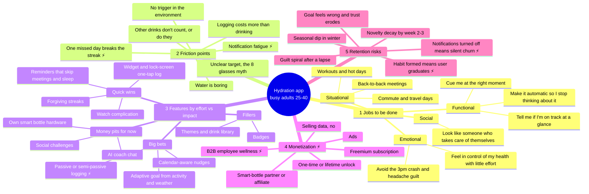

# Hydration App: Discovery Sprint Brainstorm Map

**Target user:** Busy adults, 25–40, who already *know* they should drink more water but forget. In this segment the problem is not knowing what to do. It's following through on it.

**Framing bet:** We're not competing on tracking. We're competing on **getting the user to drink at the right moment with almost no effort**. Logging only supports that.

> ⚡ = a real strategic tension to debate in the sprint (see [Tension Register](#-strategic-tension-register) at the bottom).



---

## 1. Core jobs to be done

| Type | Job statement ("When… I want to… so I can…") | Signal it matters |
|---|---|---|
| **Functional (primary)** | When I'm deep in work, I want a cue *at a moment I can actually act on it*, so I drink without breaking flow. | The stated pain is forgetting, not not knowing. |
| Functional | When I glance at my phone or watch, I want to know if I'm on track in under a second, so I don't have to think about it. | Busy users won't open an app to check. |
| Functional | Over a few weeks, I want this to become automatic, so I don't need a tool forever. | ⚡ Leads straight into the graduation problem (§5). |
| Emotional | I want to feel I'm looking after myself with minimal effort, without being judged when I slip. | Guilt is a churn driver in habit apps. |
| Emotional | I want to avoid the afternoon slump and headaches I suspect come from not drinking enough. | Gives a reason to care. Watch the medical-claim line. |
| Social | I want to be seen as someone who has their health together, at least by myself. | Weak driver. Don't build social features for it yet. |
| **Situational** | Meeting-heavy days, travel and commute, workouts, heat waves. | These are the moments when forgetting peaks. Design reminders around them. |

**Hypothesis to test:** The underserved job is *timely cueing*, not *measuring*. If interviews show users mainly want measurement, the product shape changes a lot.

---

## 2. Key friction points in current behavior

| Friction | What it looks like | Root cause | Design implication |
|---|---|---|---|
| **No environmental trigger** | "I just forget until I'm thirsty at 4pm." | Nothing cues the habit. Thirst comes late. | Cue at transition points (end of a meeting, after the commute), not on a fixed timer. |
| **Logging costs more than drinking** | Unlock, open the app, pick a cup, confirm: ~8 seconds and 4 taps. | The tracking tax | One tap from widget, watch, or lock screen. Aim for logging in ≤2 s. |
| **Unclear target** | "Is it 8 glasses? 3 litres? Does coffee count?" | Conflicting advice | Simple adaptive default with a plain explanation. No false precision. |
| ⚡ **Notification fatigue** | Reminders arrive mid-meeting and get dismissed, then muted, then notifications are turned off. | Timer-based nudges ignore context. | Fewer reminders, sent at better moments. Back off automatically when ignored. |
| **Water is boring** | Users drink coffee or soda instead. | Low reward | Count other drinks (with a hydration factor). Possible tie-ins for bottles or flavor drops. |
| **Partial-credit confusion** | Tea, coffee, sparkling water, food water | Accuracy anxiety | "Close enough" logging beats exact logging for this segment. |
| ⚡ **Lapse leads to abandonment** | One missed day breaks a 20-day streak and the user quits. | All-or-nothing gamification | Forgiving streaks: weekly targets, freezes, a "back on track" framing. |

---

## 3. Feature ideas ranked by effort vs. impact

```
            HIGH IMPACT
                 │
   QUICK WINS    │    BIG BETS
   (do first)    │    (sprint focus)
─────────────────┼─────────────────── EFFORT →
   FILLERS       │    MONEY PITS
   (only if free)│    (avoid now)
                 │
            LOW IMPACT
```

| Rank | Feature | Effort | Impact | Quadrant | Why |
|---|---|---|---|---|---|
| 1 | Home/lock-screen widget with one-tap log | Low | High | Quick win | Removes the biggest logging friction |
| 2 | Watch complication or tap-to-log | Low–Med | High | Quick win | Wrist is the lowest-friction place to log |
| 3 | Quiet hours plus "don't nudge in meetings" (OS Focus modes) | Low | High | Quick win | Cheap fix for notification fatigue |
| 4 | Forgiving streaks (weekly goal, 1 freeze/week) | Low | Med–High | Quick win | Directly targets lapse churn |
| 5 | Siri/Google Assistant shortcut ("log a glass") | Low | Med | Quick win | Hands-free while cooking or driving |
| 6 | **Calendar-aware nudges** (cue in gaps between meetings) | Med–High | High | **Big bet** | Fits the core job best and differentiates. Needs calendar permission (trust cost) |
| 7 | Adaptive goal from HealthKit/Health Connect activity and local weather | Med | Med–High | Big bet | Makes the target feel right. Must stay a wellness guide, not medical advice |
| 8 | ⚡ Passive/semi-passive logging (smart bottle, "assume I drank" confirmation) | High | High (if accurate) | Big bet | Removes logging altogether, but accuracy and hardware dependence are risks |
| 9 | Weekly insight ("you hit goal on 4/5 workdays; Mondays are weakest") | Med | Med | Big bet-lite | Keeps users past week 3. Candidate premium feature |
| 10 | Themes, drink library, custom cups | Low | Low | Filler | Pleasant, but nobody stays for them |
| 11 | Badges/achievements | Low | Low–Med | Filler | Risk of feeling childish for this segment |
| 12 | Social challenges and leaderboards | High | Low (now) | Money pit | Needs network effects. Revisit with B2B teams |
| 13 | LLM "hydration coach" chat | Med–High | Low | Money pit | Users want less interaction, not more. Liability on health advice |
| 14 | Our own smart bottle | Very high | Uncertain | Money pit | Partner instead of building |

**Sprint recommendation:** Ship quick wins 1–4 as the baseline. Spend discovery effort on validating #6 (calendar-aware cueing), because it's the most defensible differentiator.

---

## 4. Monetization paths with tradeoffs

| Path | How it works | Pros | Cons / risks | Fit |
|---|---|---|---|---|
| **Freemium subscription** (~$2–5/mo) | Core logging and reminders free. Paid tier: smart/calendar nudges, insights, integrations | Recurring revenue, standard in the category | ⚡ Users who form the habit stop needing it and cancel. Hard to sell to people with many free alternatives | Medium |
| **One-time/lifetime unlock** | Pay once for premium features | Matches a "graduate when done" product. Low friction for a small purchase | Lower LTV. Fewer resources for ongoing development | Medium–High for the B2C wedge |
| ⚡ **B2B employee wellness** | Sell seats via corporate wellness programs (team challenges, aggregate dashboards) | Higher contract value, lower CAC per user, and companies pay rather than users | Long sales cycles. Product pulled toward employer dashboards. Employee data privacy is sensitive. Different buyer from user | High upside, high distraction |
| **Smart-bottle partnership/affiliate** | Integrate with existing bottles and earn a referral or rev-share | No hardware risk. Supports passive logging | Small share of the segment owns smart bottles. Dependent on partners | Low–Med (supplement only) |
| **Ads** | Banner/interstitial in the free tier | Revenue from non-payers | Undermines the calm, low-friction experience, which is the value. Health-adjacent ad targeting raises privacy risk | Low. Avoid |
| **Selling or sharing user health data** | n/a | n/a | Breaks trust, invites regulatory risk (e.g. state consumer-health-data laws, App Store health-data rules) | ❌ Off the table |

**Open question for the sprint:** Is the business "a tool people pay for until the habit sticks" (one-time, B2C) or "an ongoing wellness layer an employer pays for" (B2B)? These lead to different roadmaps. See Tension T2/T5.

---

## 5. Retention risks and mitigations

| Risk | When it hits | Leading indicator | Mitigation |
|---|---|---|---|
| **Novelty decay** | Week 2–3 | Drop in logs per active day | Weekly insights with something new each week. Progressively unlock adaptive features |
| ⚡ **Notifications disabled = silent churn** | Week 1–2 | Notification opt-out rate. Reminder ignore rate | Adaptive frequency that backs off when ignored. Let users choose "fewer but smarter." Widget as a fallback cue that needs no permission |
| ⚡ **Graduation** (habit formed, app no longer needed) | Month 2+ | Users hit goal without opening the app, then go inactive | Treat it as success: a "maintenance mode" with weekly check-ins. Pricing that doesn't depend on daily use. Possibly adjacent habits later (T4) |
| **Goal feels wrong** | First week | Goal edits, early churn after day 1 | Explain the goal plainly. Easy override. Adjust gradually |
| **Guilt spiral after a lapse** | Any time | Streak break, then inactive within 3 days | Forgiving streaks, "welcome back" (not "you failed"), weekly targets instead of daily |
| **Seasonal dip** | Winter | Month-over-month cohort decline in cold regions | Weather-adaptive messaging (dry heating, winter workouts). Accept some seasonality |
| **Logging drift** (drinking but not logging) | Week 3+ | Gaps in logs among otherwise engaged users | Lower logging cost further. "Did you drink around lunch?" one-tap backfill |

---

## ⚡ Strategic tension register

These tensions don't have an obvious right answer. Each needs a debate and a decision in the sprint.

| # | Tension | Side A | Side B | What would settle it |
|---|---|---|---|---|
| **T1** | **Nudge intensity vs. annoyance** | More reminders mean more drinking. Reminders *are* the product | Too many lead to notifications off, and then the product is dead | Test reminder frequency (fixed vs. adaptive) against D14 notification retention *and* intake |
| **T2** | **Habit success vs. subscription revenue** (the graduation paradox) | Build for lasting engagement and recurring revenue | Build to make the habit automatic. A user who succeeds may leave | Interviews: do people *want* to graduate? Pricing test: lifetime vs. monthly |
| **T3** | **Logging friction vs. data accuracy** | Estimate loosely ("assume I drank"), so engagement is easy | Precise logging builds trust and supports insights | Does accuracy affect behavior change for this segment, or just feel good? |
| **T4** | **Focused single-purpose app vs. habit platform** | Do one job extremely well. Easier to explain and build | Water alone may be too small a market and too easy to graduate from. Expanding to sleep, movement, and breaks raises LTV | Check whether hydration retention ever reaches a viable level before expanding |
| **T5** | **B2C wedge vs. B2B wellness channel** | B2C keeps the product user-centered and fast to iterate | B2B fixes CAC and monetization but pulls the roadmap toward buyers' dashboards | 5–8 conversations with wellness/benefits buyers in parallel with user interviews |
| **T6** | **Personalization vs. health-claim and privacy exposure** | Adaptive goals from health data are the main differentiator | Personalized intake guidance edges toward medical advice. Health data creates privacy and regulatory obligations. At-risk users (kidney/heart conditions, pregnancy) need safeguards | Bring legal/regulatory review in early. Define the "general wellness" boundary and a safety-cap policy before building #7 |
| **T7** | **Gamification vs. a calm, adult experience** | Streaks and badges drive short-term engagement | Busy adults find them childish, and streaks cause guilt-driven churn | Test forgiving streaks against no streaks on D30 retention |

---

## Discovery sprint: assumptions to test first

Ordered by risk × uncertainty:

1. **Forgetting (cueing) is the main problem, more than logging friction.** → Diary study, 5–7 days, with ~10 target users.
2. **Users will grant calendar access in exchange for better-timed nudges.** → Fake-door permission prompt in the prototype.
3. **Users don't mind estimated logs if the cue works.** → Concept test of "assume I drank" vs. manual logging.
4. **This segment would pay once rather than subscribe.** → Price-sensitivity questions (Van Westendorp) plus a willingness-to-pay test for both models.
5. **Employers would buy this as a wellness benefit.** → Buyer interviews (T5).

**North-star candidate:** % of active users' *workdays* on which they met their goal. This measures behavior change, not app opens.

---

*Note: This is AI-assisted brainstorm material. Validate it with real user research before it drives roadmap decisions, and get legal/regulatory review before building anything that personalizes intake from health data (T6).*
