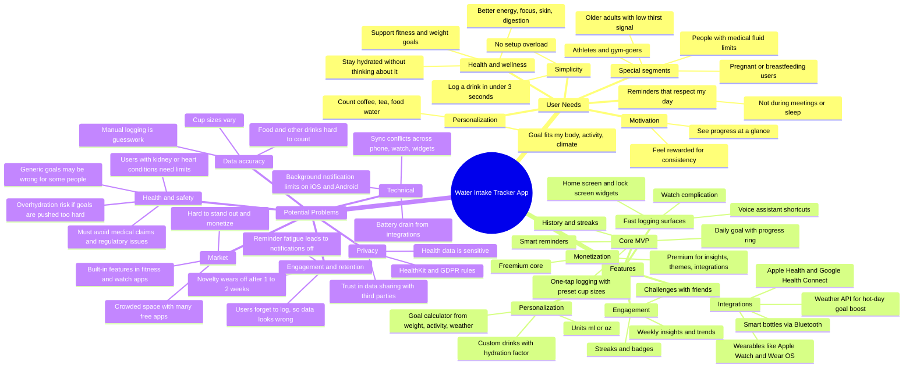

# Water Intake Tracker: Product Mindmap

## Prioritization notes (PM view)

| Area | Priority | Rationale |
|---|---|---|
| One-tap logging, widgets, watch | **P0** | Logging friction is the main reason users quit |
| Personalized goal + safety caps | **P0** | Core value and protects at-risk users |
| Smart, context-aware reminders | **P0** | Drives the habit without fatigue |
| Health app sync | **P1** | Table stakes for health-focused users |
| Insights, streaks, badges | **P1** | Retention lever after week 2 |
| Social challenges, smart bottles | **P2** | Nice to have; validate demand first |

## Key metrics to watch

- **Activation:** % of new users who log 3+ drinks on day 1
- **Retention:** D7 / D30 retention (biggest risk area)
- **Habit strength:** average logs per active day; % of days goal met
- **Reminder health:** notification opt-out rate; log rate within 15 min of a reminder
- **Monetization:** free-to-premium conversion rate

## Open questions to validate with research

1. Is friction or forgetting the main cause of churn?
2. Will users pay for integrations and insights, or only for a smart bottle bundle?
3. How do we handle users with medical fluid limits safely (disclaimers, opt-in clinician mode)?
